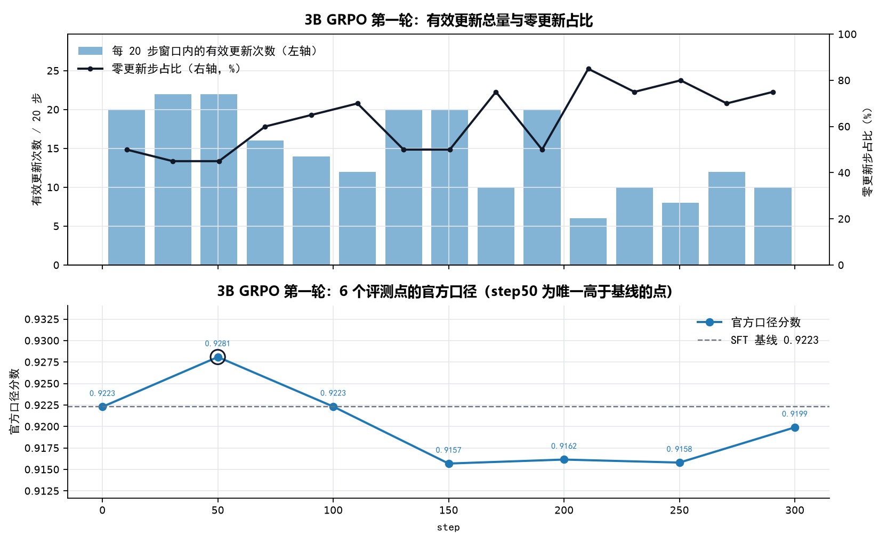

# 3B GRPO 第一轮 · 结果分析

> 本文是**事后补写**（2026-11-10）。当时的结论只写进了 `RECORD.md` 的"结论"一节，量化留给后面几轮；
> 补写时用本地归档的 `*_metrics.json` 与 `rollouts.jsonl` 重新算过，所有数字可用 `_audit/` 下脚本复现，
> 不与原始记录冲突，只做加法。

---

## 1. 五条结论

1. **这一轮的真实效果是"没效果"**：官方口径只有 step50 一个点高于 SFT 基线（+0.0058），其余 5 个点全部低于基线（−0.0024 ~ −0.0066）。而这 +0.0058 有 92% 来自**情绪宏 F1 的单点跳升**（0.9403 → 0.9510），冲突判定只贡献 +0.00045——step50 是 7 个检查点里唯一一次情绪 F1 破 0.95，属评测波动，不是能力提升。
2. **冲突识别能力没有任何提升**：74 条真冲突上，TP 全程在 56–58 之间（SFT 是 57），召回 75.7%–78.4%。GRPO 没有让模型"更会找冲突"，只是把判定阈值上下推了一点。
3. **代价直接记在误警上**：FP 从 51 涨到 57（+6 条），一致样本特异度从 0.9139 掉到 0.9037（−0.0102）。step300 时 TP 回到 57、FP 停在 57 → 净亏。
4. **梯度几乎只从冲突样本流出**：600 个训练组里仅 113 组（18.8%）的 8 个候选奖励存在差异，其中 **110 组是冲突样本（97.3%）**；300 个一致样本组里只有 3 组产生梯度。一致样本占训练集一半，却基本不参与学习——没人教模型"不要在一致样本上误报"。
5. **这就是后面所有轮次反复复现的同一个坑**：r2 把有效组提到 32.2%、PPO 换成 critic、7B 换更大模型、DAPO 换算法，FP 依旧只涨不跌。根因不在算法，在奖励与数据。

---

## 2. 设置（`config.json` 原文）

| 项 | 值 | 项 | 值 |
|---|---|---|---|
| 基座 | Qwen2.5-Omni-3B + SFT adapter | 采样 | temperature 1.1 / top_p 0.95 |
| steps | 300 | candidates | 8 / 组，2 组 / 步 |
| lr | 2e-6 | ppo_epochs | 2 |
| KL β | 0.02 | clip ε | 0.2 |
| 冲突采样 | `original_conflict_prob` 0.67 | 冲突优势放大 | `conflict_advantage_scale` 1.5 |
| 评测 | 每 50 步，666 条验证集 | 选点保护 | `f1_drop_guard` 0.01 |
| 训练集 | 3352 条（冲突 411，其中原始 143 / 生成 268） | 验证集 | 666 条（冲突 74） |

选点结果 `best.json`：step 50，本地口径 0.893406，floor 0.930305，`eligible: true`。

---

## 3. 逐检查点结果

74 条真冲突、592 条一致样本；`TP/FP/FN` 是冲突位混淆矩阵。评分用的是 `all.emotion_macro_f1_present`（情绪综合宏 F1），不是视觉子项，两者数值不同，表中分列。

| 检查点 | 官方口径 | Δ vs SFT | 本地口径 | 情绪宏F1（计分项） | 视觉F1 | is_conflict 准确率 | 冲突F1 | 召回 | 特异度 | TP/FP/FN |
|---|---|---|---|---|---|---|---|---|---|---|
| SFT 基线 | 0.922292 | — | 0.884004 | 0.94031 | 0.9414 | 0.89790 | 0.6264 | 0.7703 | 0.91385 | 57/51/17 |
| step 50 | **0.928091** | **+0.005798** | 0.893406 | **0.95100** | 0.9420 | 0.89940 | 0.6339 | 0.7838 | 0.91385 | **58/51/16** |
| step 100 | 0.922324 | +0.000031 | 0.884936 | 0.94352 | 0.9412 | 0.89489 | 0.6196 | 0.7703 | 0.91047 | 57/53/17 |
| step 150 | 0.915688 | −0.006604 | 0.876049 | 0.93588 | 0.9353 | 0.88889 | 0.6022 | 0.7568 | 0.90541 | 56/56/18 |
| step 200 | 0.916152 | −0.006140 | 0.880566 | 0.93748 | 0.9363 | 0.88889 | 0.6064 | 0.7703 | 0.90372 | 57/57/17 |
| step 250 | 0.915801 | −0.006491 | 0.883819 | 0.93588 | 0.9362 | 0.89039 | 0.6138 | 0.7838 | 0.90372 | 58/57/16 |
| step 300 | 0.919901 | −0.002392 | 0.884315 | 0.94498 | 0.9360 | 0.88889 | 0.6064 | 0.7703 | 0.90372 | 57/57/17 |

> `is_conflict 准确率` = (TP + TN) / 666，即"是否冲突"这一位在**全体 666 条**上的准确率，不是只在冲突子集上算。所以 FP 每多一条，它会掉 1/666 ≈ 0.0015。



### 3.1 step50 的 +0.0058 拆开是什么

官方口径 = 0.5×情绪宏F1 + 0.3×is_conflict 准确率 + 0.2×一致特异度。step50 相对 SFT：

| 成分 | 变化 | 对总分的贡献 | 占比 |
|---|---|---|---|
| 情绪宏F1 | 0.94031 → 0.95100（+0.01069） | **+0.00535** | **92%** |
| is_conflict 准确率 | 0.89790 → 0.89940（+0.00150） | +0.00045 | 8% |
| 一致特异度 | 0.91385 → 0.91385（不变） | 0 | 0 |
| 合计 | | +0.00580 | 100% |

**几乎全部来自情绪 F1 的一次跳升**，而冲突判定只贡献 0.00045。也就是说 step50 的"最好"跟这一轮想训练的冲突能力基本无关：

- 情绪宏 F1 在 7 个点里只有 step50 破 0.95，step300 又回到 0.9450，中间三连跌到 0.9359；
- 采样温度 1.1、666 条验证集，情绪三分类的宏 F1 在 666 条上抖动 ±0.01 属于正常范围；
- 冲突侧真正的动作是"多抓 1 条 + 误警不增"，而这两件事在 step100 就还回去了（TP 回 57、FP +2）。

### 3.2 之后为什么一路往下

不是"训崩了"，是**阈值单向下移、情绪任务被拖累**：

- 情绪宏 F1 从 0.9510 掉到 0.9359（step150 见底），是总分下滑的最大单项；
- 冲突召回在 0.7568–0.7838 之间来回，**没有单调上升**；
- 特异度从 0.91385 单调掉到 0.90372，三连降之后再没回来 —— 这是唯一有方向的量；
- is_conflict 准确率同步从 0.8979 掉到 0.8889（等价于 FP 从 51 涨到 57）。

方向唯一、幅度单调的那个指标是误警。这与后面 7B 侧"TP 恒定 60、FP 33→41"是同一形状，只是 3B 的幅度小（FP +6 vs +8）。

---

## 4. 训练过程：梯度从哪来

| 指标 | 数值 |
|---|---|
| 训练步数 / 尝试组 | 300 步 × 2 组 = 600 组 |
| **零更新步** | **189 / 300（63%）** |
| 有效组（贡献梯度） | **113 / 600（18.8%）** |
| 全部候选 8 个都对 | 476 / 600（79.3%） |
| 组内 8 个候选全同但非全对 | 11 / 600（1.8%） |
| 累计有效更新次数 | 222（≈113 组 × 2 ppo_epochs） |
| 平均候选奖励 | 0.9666 |
| **组内奖励零极差（无梯度）占比** | **81.2%** |

**最要紧的一行**：113 个有效组里，**110 个是冲突样本（97.3%）**，一致样本只有 3 个。

训练集本身是 300 冲突 + 300 一致。注意这是**上采样后**的比例：原始训练集 3352 条里冲突只有 411 条（12.3%），采样把它抬到了 50%。即便这样，一致样本依然只贡献 1% 的梯度。

也就是说：

- 冲突样本：110/300 = **36.7%** 的组能产生梯度；
- 一致样本：3/300 = **1.0%** 的组能产生梯度。

模型在冲突样本上还有东西可学（判不判、判成什么），在一致样本上几乎"闭眼全对"，于是梯度信号里 97% 都在教它"关于冲突的事"，而没有信号教它"一致样本不该报警"。FP 上升不是模型的错，是训练目标里根本没有这一项。

---

## 5. 与后续轮次的关系

这一轮暴露的机理，后面四轮各自撞了一遍，且都没绕开：

| 轮次 | 改动 | 有效组比例 | 结果 |
|---|---|---|---|
| **本轮（3B GRPO r1）** | 基线配方 | 18.8% | 只有 step50 微超基线，FP +6 |
| 3B GRPO r2 | 改 attempt 级采样与奖励细节 | 32.2% | 最佳 attempt400 +0.0021，仍不显著 |
| 3B PPO | 换成 actor-critic + value head | — | 最佳 attempt100 +0.0018，之后单调下滑 |
| 7B GRPO | 换 7B 基座 | 10.0% | 5 个点全部低于 7B SFT 起点 |
| 7B DAPO | 换算法 + 四项补丁 | 11.0% | 12 个评测点无一高于 SFT，FP 33→50 |

**有效组比例从 18.8% 提到 32.2%（r2）并没有换来更好的榜分**；7B 上有效组只剩 10%，奖励饱和更严重。所以"让更多组有梯度"不是解法，"让梯度指向正确方向"才是——这条结论最终在 DAPO 轮被写实（见 `2026-11-01-DAPO/docs/06_结果分析.md`）。

另一条被本轮坐实的结构性事实：`conflict_consistency_on_valid = 1.0`、`format_valid_rate = 1.0`（7 个检查点全部成立）。`is_conflict` 位与两个标签位 100% 自洽，四个输出字段实际只有两个自由度——这与 7B 侧 734 条零例外的结论一致，说明这是数据/标签构造决定的，不是模型学出来的。

---

## 6. 局限

- **没有显著性检验**：本轮只有 7 个点，且 step50 的增益建立在 1 条样本上，做 bootstrap 也只会在 0 附近给出宽区间。跨 16 个历史检查点的配对 bootstrap 已在 `_audit/official_score_bootstrap.py` 做过，官方口径无一显著，本轮在其中。
- **没有优化侧曲线**：训练脚本只落盘了组级计数，`policy_loss` / `kl` / `grad_norm` 从未写入（3B 与 7B 的 GRPO 脚本同样问题），所以"是否发散/策略偏移多快"无法回答。能画的只有奖励侧与组级信号，见 `docs/05_训练曲线数据清单.md`。
- **奖励侧只能离线重算**：`rollouts.jsonl` 记录了每组 8 个候选的奖励，可以还原平均奖励、组内方差、零梯度组比例，但没有 loss。
- **验证集与测试集冲突先验不同**（14.0% vs 17.7%），本轮的绝对分数不能直接外推到榜分；这一轮最终**没有提交**，榜分未知。

---

## 7. 复现

```bash
python _audit/build_all_curves.py    # 本文第 3 节的表与图数据
python _audit/build_reward_curves.py # 第 4 节的奖励侧统计
```

原始记录见同目录 `grpo_runs/pilot_01/RECORD.md`；检查点权重（6 个 LoRA，约 1.4 GB）未归档，只保留了非权重产物。
